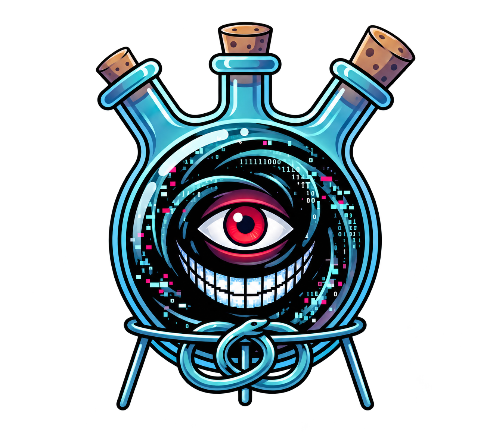

# DWARF



DWARF is a security test framework for Cardano node implementations.
It sends controlled workloads to real `cardano-node` and Amaru processes.
It records the target identity, assertions, measurements, and run evidence.

## What DWARF is

DWARF starts a topology or uses an existing topology.
It sends valid, invalid, malformed, high-load, recovery, and fault workloads to the nodes.
It checks explicit assertions and records the results.

DWARF does not simulate either node.
A catalog entry describes a test or collector.
The entry does not prove that the test ran.
Only retained evidence from a real-node run can support a runtime claim.

The repository contains code, definitions, schemas, build scripts, and documented evidence identities.
It does not contain private retained runtime bundles, operator logs, credentials, or local machine state.

## Quick start with GitHub Actions

Run stock node measurements on GitHub-hosted runners and view the results in your
browser. You do not need to install DWARF or Docker locally for this flow.

### Submit Amaru source

1. Put one complete Amaru source tree in
   `dwarf/testplease/amaru/<candidate-name>/`. Put `Cargo.toml`, `Cargo.lock`,
   and `crates/` directly inside that directory. See the
   [source layout guide](dwarf/testplease/README.md).
2. Commit and push the source change to this repository using an account with
   write access. That push starts **DWARF security campaign** with the
   `stock-amaru` scope. No `candidate.yaml` or client build script is needed.
3. Open the [workflow run](https://github.com/pragma-org/dwarf/actions/workflows/dwarf-security-campaign.yml).
   It builds the submitted source, prepares and calibrates the runtime, runs the
   stock measurement scenario with its control, and exports the evidence.

### Start a run manually

Open **Actions → DWARF security campaign → Run workflow**. Select the branch and
choose a campaign scope, then click **Run workflow**:

| Scope | Workload |
| --- | --- |
| `stock-amaru` | Stock measurements for the submitted Amaru source. This is the default. |
| `stock-cardano` | Stock measurements for the configured Cardano-node **11.1.2** release. |
| `stock-solo` | Amaru stock measurements, followed by Cardano stock measurements. |

Manual runs use the committed Amaru source for the shared preparation steps.
The repository includes a source candidate for this purpose.
The solo scenarios retain resource, workload, sync, network, header and block
measurements, with availability recorded for each metric.

### View the output

1. When the workflow finishes, open its summary and download the
   `dwarf-workload-measurement-*` artifact for each workload. Actions retains
   these artifacts for **30 days**.
2. Extract the downloaded ZIP. Inside it, find the control and measured run
   archives at `campaign-runtime/runs/<run-id>/outputs/export/*.tar.gz`.
3. Open the [DWARF results viewer](https://pragma-org.github.io/dwarf/).
   On **Runs**, expand **Import**, choose the `.tar.gz` files, and click
   **Open read-only**. You can select several archives together.
4. Open a run to inspect its assertions, measurements and evidence. Open
   **Comparison** to compare the imported results. In **Filters**, choose the
   workload and set **Grouping → Individual runs** to see the control and
   measured run separately. Enable **Include unmeasured metrics** to inspect
   unavailable signals.

Import reads the files locally in your browser. To share results, share the
archives so another person can import them into the viewer.
Read the [runner guide](dwarf/docs/security-campaign-automation.md) for execution
details and the verified hosted-run records.

## Quick start with Docker

Install these host tools first:

- Git, Bash, and Python 3.
- Docker Engine with Docker Compose v2 on Linux, or Docker Desktop on macOS.

Make sure Docker is running.
Keep sufficient storage for images, topology data, and retained runs.
Check that the node images support your container architecture.
The release installer checks Linux amd64 and macOS arm64 hosts.
This source installation builds images locally.

Run these commands from a terminal:

```bash
git clone https://github.com/pragma-org/dwarf.git
cd dwarf
bash delivery/scripts/install.sh
```

The build requires a clean Git checkout.
A downloaded source ZIP does not contain the required Git metadata.

The installer seeds the writable catalogs.
It builds `dwarf/framework:current` and `dwarf/controller:current`.
It downloads missing digest-pinned node images.
It starts the dashboard and local controller.
It checks readiness and matching source revisions.
A failed node-image download stops startup.

Open [http://127.0.0.1:8787/](http://127.0.0.1:8787/).
Select **Start run** to open `/run`.

Readiness checks are part of installation; `status.sh` is not a required installation step.
For an optional diagnostic, run:

```bash
bash delivery/scripts/status.sh
```

### Optional host capabilities

To request both optional host capabilities, use this command instead of the default installation command:

```bash
bash delivery/scripts/install.sh --all
```

`--all` requests the legacy SSH channel and the host-side AFL coverage harness.
It does not install every scenario prerequisite or prepare every patched node.
It does not configure Moog wallets, Antithesis credentials, or external services.

The SSH channel needs OpenSSH tools and an accessible SSH server.
It changes the deploying user's SSH configuration.
The AFL harness needs GHC 9.6.7, Cabal, build dependencies, and additional storage.
The setup can request `sudo` for host installation directories.
Read [INSTALL.md](INSTALL.md) before you use these options.

Check the installation summary for both optional capabilities.
The installer can finish with either capability marked `FAILED`.
A running dashboard does not prove that those capabilities work.

### Access and credentials

The dashboard binds to `127.0.0.1` by default.
The installer creates separate random dashboard and controller credentials.
It keeps them under `~/.local/share/dwarf/state/` with owner-only permissions.
The installer prints the dashboard token file path, not the token or a tokenized URL.
Keep credentials private.

Use SSH port forwarding for a remote installation.
Set `DWARF_DASHBOARD_BIND=0.0.0.0` only for deliberate LAN access.
Restrict LAN access with a firewall or an authenticated reverse proxy.
The dashboard token is not a replacement for network access control.

The local controller is enabled by default.
It handles the Basic Prepare → Run → Evidence workflow.
That workflow does not require `--control-channel`.
The optional channel supports legacy SSH operations and host-side coverage.

### Local-source developer path

To use the Python framework without the dashboard container, prepare a virtual environment:

```bash
python3 -m venv .venv
. .venv/bin/activate
python -m pip install -r infrastructure/docker/requirements-framework.txt
python3 dwarf/cardano-profile --help
python3 dwarf/cardano-profile list-profiles
python3 dwarf/cardano-profile scenario validate --semantic dwarf/scenarios/client-example-cbor-decoding-cardano-patched.yaml
```

A real-node scenario still needs its specified images, tools, topology, data, ports, storage, and hardware.

## Run with Antithesis

Use Antithesis to run a packaged test environment through DWARF's MOOG
integration. Select **Enter the lab → Antithesis**, or open
[http://127.0.0.1:8787/run/antithesis](http://127.0.0.1:8787/run/antithesis)
on your DWARF installation. For a remote installation, use its dashboard URL.

### Set up access

Use a DWARF host with Docker and the build tools required by your selected node
artifacts. Open the wizard's settings section and configure the existing MOOG
requester: its connection settings, token, requester wallet and GitHub identity.
Use a requester and repository registered with your MOOG deployment, with access
to the Antithesis tenant. Save the settings before checking submission readiness.

For generated packages, sign in to GHCR with Docker on the DWARF host. You also
need a public GitHub repository for the exported test package. The wizard uses
the host's Docker login to push images; package visibility is set in GitHub.

### Choose the test

1. **Topology:** Keep the scenario default or select a supported Antithesis
   configuration. The page shows target nodes and supporting services.
2. **Node versions:** Select catalog releases or prepare node artifacts from
   source, a compiled binary/archive, or an image on the DWARF Docker host.
   File paths refer to the DWARF host.
3. **Scenario:** Select the workload you want to run.
4. **Measurement taps:** Select a measurement profile or individual taps.
5. **Review and prepare:** Choose the package source, duration and fault policy.
   Review which selections are applied to the package.

| Package source | Use it for |
| --- | --- |
| **Build with Dwarf** | Generate test files from your wizard choices. |
| **Use a package URL** | Load an existing ZIP or tar.gz from a direct public HTTPS URL. |
| **Use existing Compose/images** | Use a Compose project path, image references, or both on the DWARF host. |

Select **Generate package preview** for a generated package, then select
**Prepare package** to save its files and receipt. Supplied packages retain their
own configuration and images. Preparation reports connected workloads and taps,
plus any missing inputs.

### Build and deliver a generated package

1. Select **Build images** for the saved generated package.
2. Enter a GHCR repository prefix, such as `ghcr.io/your-org/dwarf`.
   Select **Prepare publication handoff**, then **Push images to GHCR**.
3. Make the resulting packages public in GitHub, then select
   **Verify public images** in DWARF.
4. Select **Download public package**. Extract the ZIP into a dedicated directory
   in your public GitHub repository. Preserve executable permissions and commit
   the files.
5. Enter the repository, full commit SHA, package directory, requester GitHub
   name and attempt number. Select **Verify Git assets and prepare request**.

For an existing package, use its published images and exact Git package location.
The generated-image build and publication controls apply to DWARF-generated
packages.

### Submit and follow the run

1. Select the saved package snapshot. Use **Check package** and
   **Inspect images/config image** to review the package and delivery checks.
2. Select **Check submission readiness**. Resolve any blocking items it reports.
3. Select **Submit to Antithesis**. Keep the saved submission check ID and receipt.
4. Use **Refresh from MOOG** to follow the request. After a reload or lost
   response, use **Recover saved status** with the saved ID.
5. Open **Run history** at `/operate/runs` to find the external run record.
   Inspect the retained status, receipt and available evidence. Measurement
   results record which signals were available and which were unavailable.

Preparation, publication and submission are separate steps. Refreshing status
follows the existing request without submitting another run. Local execution
remains at `/run`, and GitHub Actions campaigns use their existing workflow.

See the [Antithesis package checklist](dwarf/docs/antithesis-scenario-preflight-checklist.md)
and [scenario setup contract](antithesis/spec.md) for package and harness details.

## Run a real-node test

Basic is the default throughout the dashboard.
The `/run` wizard has six stages.
The required controls do not depend on an advanced URL or hidden view.

1. **Topology:** Select a profile or configure Amaru, Cardano, or mixed nodes.
2. **Node Versions:** Check the supported versions and exact artifact identities.
3. **Scenario:** Select a workload by implementation, test surface, security goal, or threat and risk references.
4. **Measurement taps:** Keep the default selection or select compatible taps.
5. **Review and prepare:** Check the changes, seed, prerequisites, and required experimental consent.
   Select **Prepare topology**.
   Wait for Ready.
6. **Run and evidence:** Start the run.
   Inspect its assertions, measurements, logs, identities, and evidence downloads.

The DWARF logo shows configuration and preparation progress.
It does not replace readiness checks.
DWARF checks a healthy, unchanged topology without another deployment.
A physical identity change requires a reviewed topology action.
Some changes also require confirmation before DWARF removes or replaces resources.

The wizard shows missing images, unsupported backends, unknown versions, and unhealthy topologies.
After a run, open `/operate/runs/<run-id>`.
A FAIL result can identify a security finding, not a framework failure.
See the [full-metrics compatibility audit](docs/measurement-full-metrics-compatibility-audit.md) for two detailed recipes and their limits.

## How DWARF is organized

- **Scenario:** A versioned recipe with workload, assertions, target, runtime, seed, and evidence requirements.
- **Target:** The implementation and executable test surface, with its manifest or image identity.
- **Deployment profile:** The topology, network, node versions, images, genesis, and lifecycle settings.
- **Primitive:** One setup, load, fault, probe, assertion, or teardown action.
- **Measurement:** One typed signal with a collector and evidence contract.
- **Measurement profile:** A compatible selection of taps. Run reports contain the measurement results.

Open `/operate/measurements` and `/operate/measurement-profiles` to inspect definitions.
Open `/learn/measurements`, `/learn/coverage`, and `/learn/threat-coverage` for explanations.

### Measurement source badges

- **Stock:** The collector uses signals from an unmodified node.
- **External:** The collector observes a process, container, network, or controller boundary.
- **Patched:** The collector needs matching node instrumentation, exact provenance, and the specified stock control.
- **Reserved:** The entry holds a future catalog position. It is not available evidence.

Measurements include counters, gauges, histograms, timing distributions, resource windows, correlations, and readiness states.
Patched targets can provide raw integer nanoseconds.
Reports also calculate fractional microseconds.
Older whole-microsecond evidence remains readable.

**Catalogued is not exercised.**
A zero, an `available` flag, or a completed collector does not prove metric coverage.
The report must contain the required samples or events within the workload window.

## Results and evidence

A run retains its resolved manifest, assertion results, event log, probe outputs, and measurement data.
It also retains applicable integrity records.
The inspector separates framework completion from the security verdict.
It distinguishes available definitions from exercised metrics.
It distinguishes missing evidence from a numeric zero.

Use the inspector to view artifacts or export a bundle.
For CLI verification, replace `RUN_ID` with a retained run identifier:

```bash
python3 dwarf/cardano-profile verify RUN_ID
python3 dwarf/cardano-profile bundle verify RUN_ID
```

The public source retains documented evidence identities and contracts.
It does not include private run directories or exported bundle archives.
See the [forensic bundle format](dwarf/docs/forensic-bundle-format.md).

## Versions and prerequisites

Open **Operate → Versions** at `/operate/versions`.
Select **Fetch Latest Version** for Amaru or Cardano to request release metadata.
An open dashboard page does not repeatedly request GitHub releases.
Metadata discovery does not download, deploy, or qualify a node.
DWARF reports GitHub rate limits as errors, not as missing versions.

For a local build, import a compatible Docker image or a supported **Linux ELF** binary or archive.
The executable must match the container architecture.
Native macOS and Windows executables cannot run in the Linux container.
DWARF packages supported binaries.
It does not compile arbitrary source trees or correct node build failures.

Use this workflow:

1. Discover or import a version.
2. Select the version.
3. Download or prepare its artifact.
4. Run applicable checks.
5. Inspect the retained evidence.
6. Record a compatibility decision for a specific scope.
7. Optionally select that version as your default.

A successful run does not automatically mark a version, scenario, tap, or mixed pair as supported.
Unknown compatibility requires experimental consent.
Patched taps need matching instrumentation and evidence.
An imported executable does not acquire missing instrumentation hooks.

Prefer `exact` or a confirmed catalog selection.
The profile and run record retain resolved versions and applicable source, executable, image, configuration, and patch identities.
An unknown or unconfirmed selection must not silently become the default.

Some scenarios require additional node images, source checkouts, toolchains, bootstrap data, protocol parameters, or cost models.
Coverage and patched targets need revision-specific builds.
Read the [version-qualified devnet guide](dwarf/docs/version-qualified-devnets.md) and [target build notes](dwarf/targets/README.md).

## Repository map

```text
delivery/                         Install, build, deploy, and status scripts
infrastructure/docker/            Image definitions and Python requirements
dwarf/cardano-profile             CLI entry point
dwarf/profile_manager/            Runner, dashboard, collectors, and evidence logic
dwarf/scenarios/                  Real-node scenario definitions
dwarf/profiles/                   Deployment and topology profiles
dwarf/primitives/                 Primitive schemas and registry
dwarf/measurements/               Measurement definitions
dwarf/measurement-profiles/       Compatible tap selections
dwarf/targets/                    Target manifests and build sources
dwarf/spec/                       Run, evidence, measurement, and contract schemas
dwarf/docs/                       Operator, security, and evidence documents
tests/                            Framework tests
tools/                            Validation and public-tree audit tools
```

Runtime data is outside the tracked source tree by default.
The default root is `${XDG_DATA_HOME:-$HOME/.local/share}/dwarf/`.
It contains runs, bundles, writable catalogs, configuration, and controller state.

## Validate and develop

For focused validation, run:

```bash
bash delivery/tests/test_delivery_contract.sh
python3 dwarf/cardano-profile scenario validate --semantic dwarf/scenarios/client-example-cbor-decoding-cardano-patched.yaml
pytest -q tests/test_public_tree_safety.py tests/test_public_readme_contract.py
```

Before a release, run the framework suite:

```bash
PYTHONPATH=dwarf:. pytest -q tests
```

Scenario validation checks schemas and semantic rules.
It does not prove image availability or successful execution.
Use prerequisite checks, topology readiness, and retained run evidence for those claims.
Read the [CI validation guide](dwarf/docs/ci-validation-gate.md).
Run Antithesis harness tests separately in their documented context.
Repository-wide collection can encounter duplicate test-module names.

## Project and documentation

**PRAGMA** maintains DWARF.
Use GitHub issues and pull requests for contributions.
Follow the test rules and [CODEOWNERS](CODEOWNERS).
The repository does not declare one repository-wide license.
A component license applies only to its component.
See the [`dwarf-adversary` license](antithesis/components/dwarf-adversary/LICENSE).

Guides and records:

- [Install guide](INSTALL.md)
- [Operations guide](OPERATIONS.md)
- [Draft Basic operator release notes](docs/releases/2026-10-14-basic-operator-update.md)
- [Security policy](SECURITY.md)
- [Version-qualified real-node devnets](dwarf/docs/version-qualified-devnets.md)
- [Primitive reference](dwarf/docs/primitives-reference.md)
- [Forensic bundle format](dwarf/docs/forensic-bundle-format.md)
- [Client-card evidence program](dwarf/docs/client-examples/README.md)
- [Full-metrics compatibility and `/run` recipes](docs/measurement-full-metrics-compatibility-audit.md)
